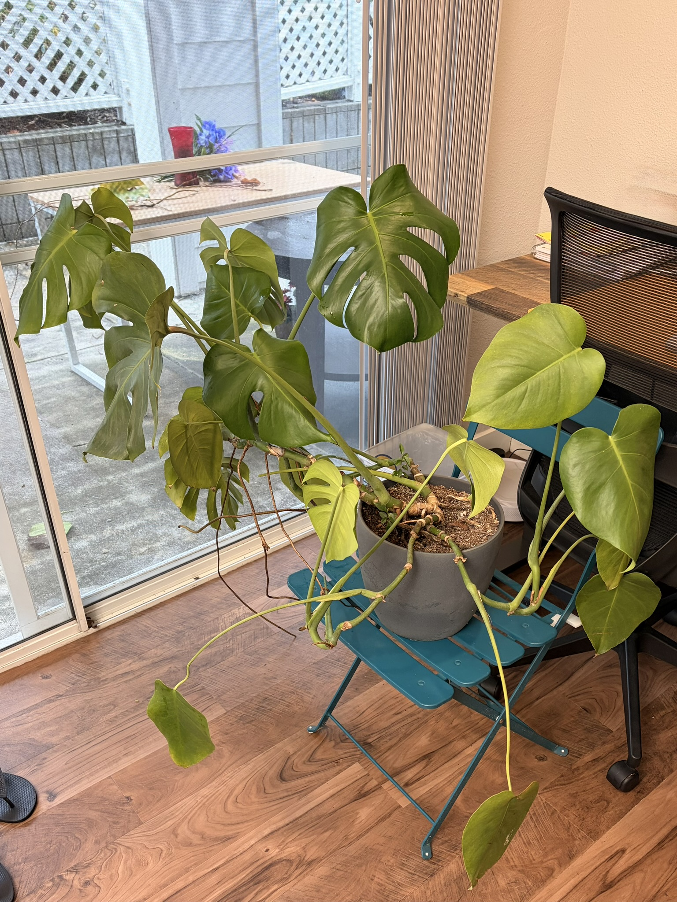
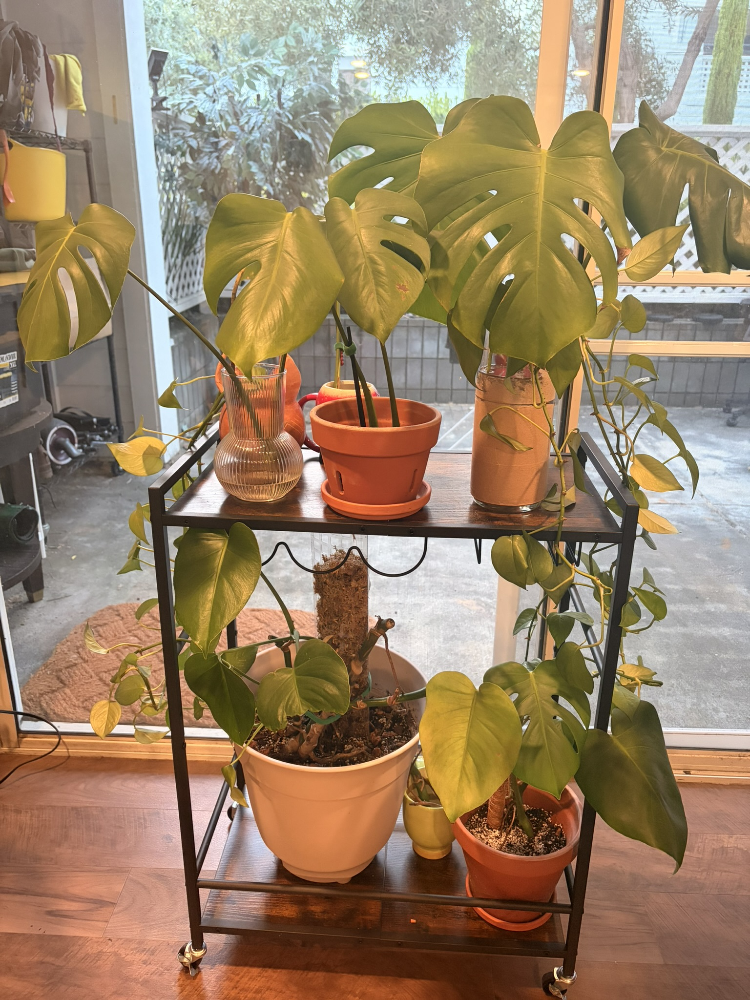
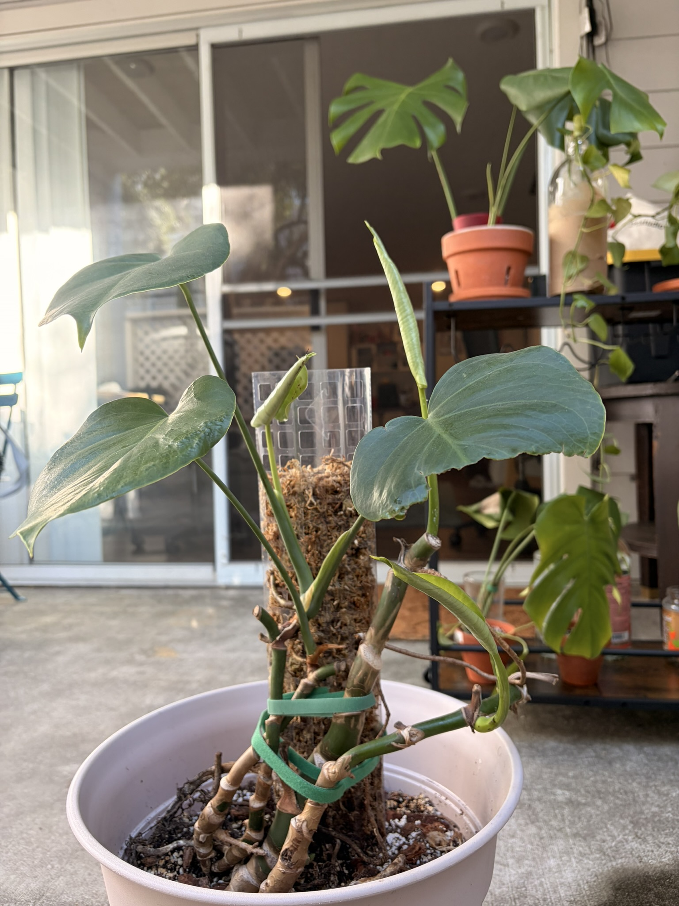
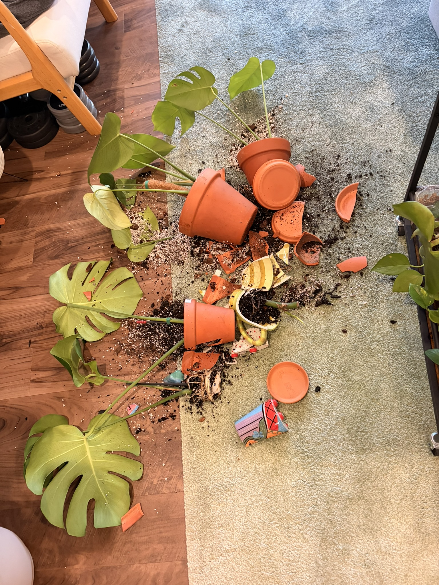

我是今年年初开始认真养植物的，本来想等到年底再来写一写这一年的心得。但是本周刚好发生了一起不大不小的事故，不如就趁着这个机会一鼓作气来写一下。

去年一个朋友的朋友要离开美国了，阴差阳错我就得到了她的一盆还挺大的龟背竹。盆里有四株，都已经长得老大了，枝繁叶茂的。最开始我其实没太上心，就随便把它放在室内，想起来就浇浇水。结果龟背竹的枝条开始横向发展，占地面积越来越大，我就索性把它放在室外了。等到了冬天，我又于心不忍，再次把它搬回室内。不过我家实在没什么位置摆这么一大盆植物，最终放在了餐厅角落里。结果因为光照不足，陆陆续续很多叶子都开始发黄，剩下的也都拼命朝着旁边的一扇窗户生长，整体造型变得惨不忍睹。

大概在圣诞节前后，我痛定思痛，下决心拯救一下。当时按照我的理解（误解），还死守着这一盆肯定是不行了，只能剪掉活力尚存的叶子水培才能延续它的血脉。第一步为了保险起见，在chatgpt的指导下，我就只剪了一个节点上的几片叶子，放在花瓶里开始水培。可能是因为冬天即使是室内对它来说也实在太冷，加上光照不足，所以最开始的几个月都没什么动静。好在当时我也只是抱着玩票的心态，所以也没太焦虑，就放任它自己努力。

等到三月底，第一胎的老大终于长出了一些水生根，于是我又张罗着买花盆、热植土、珍珠岩和树皮，把它转成了土培。与此同时我也有了一些信心，又从母体身上剪了老二继续水培。等到六月，进度实在太慢，我一不做二不休直接把母株上还残留的叶子全剪下来了，一下子变成了一大家子。

虽然已经是夏天，但是湾区晚上的气温还是经常低于二十度。责任心大增的我已经不忍心把它们留在室外受冻了，于是在亚马逊上低价购入了一个推车（埋下祸根），把植物都放车上，白天推出去晚上拉回来，这样至少不用一盆盆来回搬了。

七月份的时候我在facebook上刷到有人卖植物，去了之后发现对方是一个耳朵上全是穿孔、衣着朋克的光头大哥，但是讲话却非常温柔。我从他那用六块钱就买了两瓶枝繁叶茂的水培绿萝（用两个巨大的伏特加酒瓶装着），感觉超值。

接着我还给如今已经秃了的母株换了盆，加了水苔柱，这样新长出来的枝叶就可以顺着向上攀爬了，而不是像原来一样满地横向生长。换盆时我才发现从上一任主人那继承过来的花盆底部竟然没有排水孔，怪不得以前不管怎么浇水都漏不出来，我还以为是因为花盆太大了。没想到母株竟然在这样恶劣的坏境下都没烂根，真是可歌可泣了。单车变摩托之后果然立竿见影，到八月母株就从秃瓢状态长出新叶了。

夏末秋初，所有植物都在适合的环境中茁壮成长，我也变得越来越老练，陆续把所有的龟背竹都从水培转成了土培。母株长出了很多气生根，第一胎老大也在历经了大半年之后终于长出了第一片新叶。我在买水果的时候突然发现装猕猴桃的盒子很适合做绿萝的花盆，所以一连好几周都为了那个盒子去买猕猴桃，新时代的买椟还珠了。

不出意外的话那就要出意外了。随着气温慢慢下降，我睡觉时已经开始在卧室开暖气了，所以晚上也顺便把推车从客厅推到卧室里。结果上周一早晨，刚起床的我浑浑噩噩地把推车从卧室拉回到客厅。

